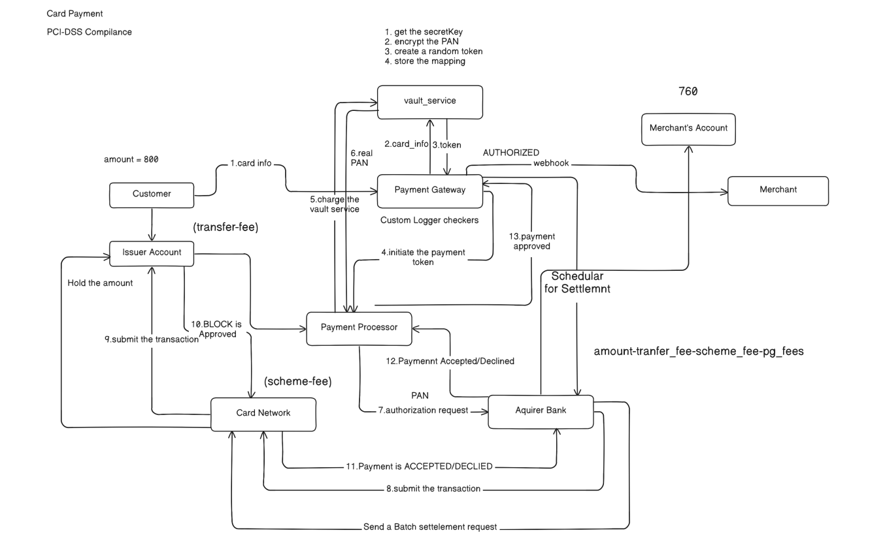
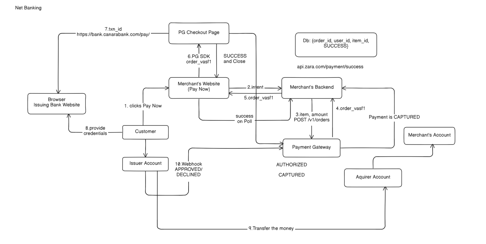
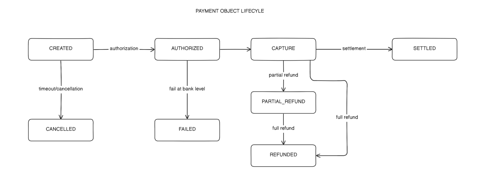
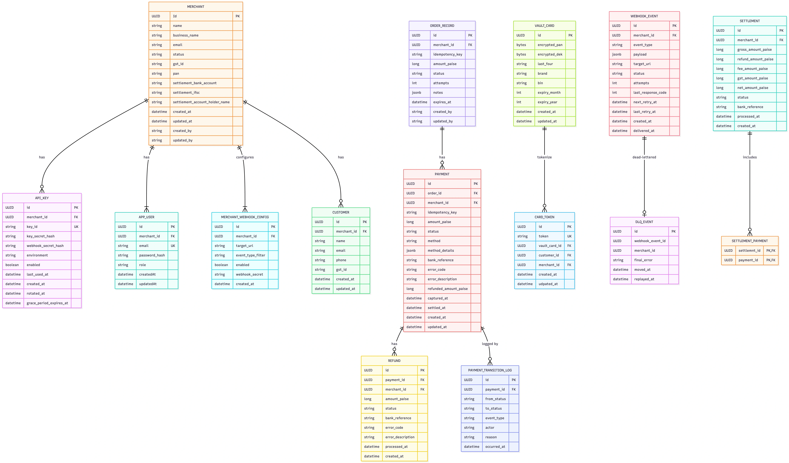
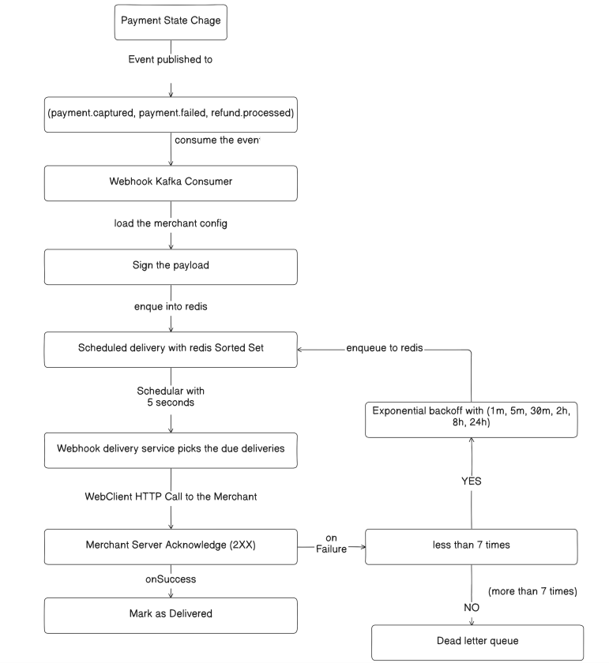

# Veyra

Veyra is a distributed payment gateway and payment processing platform built with Java and Spring Boot. It is designed around its own payment processor and method-specific integrations, giving merchants a unified way to initiate and manage payments across Card, UPI, Net Banking, and Wallet without relying on third-party payment gateway APIs as the core processing layer.

Veyra is architected toward a throughput target of 10,000 transactions per second, with reliability, secure card tokenization, idempotent payment operations, asynchronous webhook delivery, and settlement workflows as key design goals. Its broader platform vision includes merchant onboarding, multi-tenant security, payment lifecycle management, refunds, and transaction analytics.

## At a glance

- **Backend:** Java 25, Spring Boot 4.0.7, Spring MVC, Spring Data JPA
- **Database:** PostgreSQL
- **Design:** layered services, Strategy and Adapter patterns, payment state machine, repositories, DTOs, MapStruct mappers
- **Payment methods modeled:** Card, UPI, Net Banking, and Wallet
- **Project status:** active development; processor behavior is simulated and several security and reliability features remain planned

## Architecture context

The diagrams provide context for the payment flows and data model Veyra is being designed around. The card and Net Banking diagrams illustrate example participant interactions. The lifecycle and schema diagrams describe the broader target domain, while the webhook diagram lays out a planned asynchronous delivery pipeline.

### Example card payment flow

This diagram shows the intended responsibilities across the cardholder, vault, gateway, processor, card network, and acquiring bank. Veyra currently contains the vault and routing building blocks, but does not connect to those external networks or implement the complete illustrated flow.



### Example Net Banking flow

This sequence shows how a customer may leave the merchant checkout to authenticate with their bank, then return through a bank callback or status check. It is a design illustration; the current repository does not include a live bank redirect or callback integration.



### Payment lifecycle

The lifecycle diagram captures the payment states the domain is intended to represent, including authorization, capture, settlement, cancellation, and refunds. The code currently has an explicit transition table and transition log, though not every lifecycle operation shown here is wired to an API or processor.



### Target data model

This is a broader target schema covering merchant accounts, orders, payments, tokenized cards, refunds, webhooks, settlements, dead-letter records, and transition logs. Some of these entities exist in the code, while others are future design scope; the diagram should not be read as a guarantee that the current database matches every field or relationship shown.



## Implemented foundation

### Payment domain and state changes

Veyra models orders and payment attempts as separate domain objects. A payment attempt is associated with an order, merchant, amount, method, method details, status, processor reference, and error information. Orders track their status, attempt count, receipt, notes, and expiry.

Payment status changes go through a dedicated `PaymentStateMachine` and `PaymentTransitionService`, rather than being scattered as arbitrary status assignments. The state machine maps an existing status and a payment event to an allowed next status and rejects unsupported transitions. The transition service applies the change and records a `PaymentTransitionLog` with transition metadata such as the event, target state, actor, and time. This gives the payment workflow an explicit state model and a foundation for auditing.

The current transition table covers representative authorization, capture, refund, settlement, cancellation, and timeout transitions. The service layer currently invokes some of these transitions during payment failure and capture flows; the full lifecycle in the diagram is not yet connected end to end.

### Pluggable payment routing

The payment integration boundary is split into two stages:

1. `PaymentGatewayRouter` selects a `PaymentAdapter` based on the requested payment method.
2. Method adapters prepare method-specific requests and route them through `PaymentProcessorRouter` to a `PaymentProcessor` strategy.

This Strategy and Adapter structure follows the Open/Closed Principle: adding or changing a processor integration can be isolated behind the existing contracts, instead of growing one large conditional in the payment service. Adapter classes are defined for all four methods, with method-specific work at different stages of completion:

- **Card:** delegates token lookup and decryption to the vault service, then routes the charge through the processor strategy. Card capture is not implemented yet.
- **UPI:** builds a UPI processor request and maps simulated success, pending, or failure results into gateway results.
- **Net Banking:** builds a bank-specific processor request and maps simulated processor results into gateway results.
- **Wallet:** the adapter and processor routing entries exist, but their current methods are stubs.

These are integration seams and simulated processors, not connections to real banking systems. The layered routing design is in place; provider-specific behavior and complete payment lifecycles remain future work.

### Card tokenization vault

The vault endpoint validates card input, generates a random token and per-card data encryption key (DEK), encrypts the PAN with AES-GCM, and stores the encrypted DEK alongside the encrypted PAN. The token record links the merchant/customer to the vault record, allowing subsequent code to look up a card by token. PAN data is not returned in the tokenization response.

This is an implementation exercise, not a claim of PCI DSS compliance or approval to process real cardholder data. Key management, operational controls, security review, and compliance validation are not complete.

### Merchant and API-key domain

Merchant signup creates a merchant and an initial owner account. API key endpoints model key creation, listing, revocation, and rotation, including a previous-key grace-period field. These flows establish the domain and API shape, but authentication and safe password/secret hashing still need implementation before they can protect a real integration.

### API and persistence structure

The project uses Spring MVC controllers, validated request DTOs, service classes for business rules, Spring Data JPA repositories, and MapStruct entity/response mappings. A shared `Money` value type stores integer currency units with a currency code. Selected domain errors are translated into HTTP responses through a global exception handler.

## Planned reliability architecture

The following capabilities are future scope. They are architectural plans, not features currently delivered by the application.

### Asynchronous webhook delivery, retries, and dead-letter handling

Payment state changes such as `payment.captured`, `payment.failed`, and `refund.processed` will produce merchant webhook events. The proposed pipeline is:

1. **Create the event with the business change.** A payment transition creates a durable webhook/outbox event containing the event type, merchant, payload, and delivery metadata.
2. **Publish through Kafka.** An outbox publisher will relay committed events to Kafka. A webhook Kafka consumer will read them and load the merchant's enabled webhook configuration and target URL.
3. **Prepare a signed delivery.** The consumer will sign the payload with the merchant's webhook secret so the receiving service can verify authenticity.
4. **Schedule due deliveries.** The consumer will enqueue delivery work in a Redis sorted set, using the next-attempt time as the score. A background worker will periodically claim due entries and make HTTP requests to the merchant endpoint.
5. **Record success or schedule a retry.** A 2xx response marks the delivery complete. A timeout, connection failure, or non-2xx response increments the attempt count and schedules another attempt using backoff.
6. **Move exhausted events to a dead-letter queue.** The planned policy is **seven total delivery attempts**: the initial request followed by up to six retries at 1 minute, 5 minutes, 30 minutes, 2 hours, 8 hours, and 24 hours. After the final failure, the event moves to a dead-letter queue for inspection and controlled replay by a developer/operator.

The worker must claim due jobs safely so multiple instances do not send the same scheduled attempt concurrently. Delivery state and retry history should remain observable and recoverable; Redis is planned for due-time scheduling, while durable event state and replay controls need a persistent source of truth.



### Idempotency and Redis

Payment initiation will accept an idempotency key so a client retry caused by a timeout or lost response does not create a second payment attempt or charge. The key will be scoped to the merchant and operation, associated with a request fingerprint and the original result, and protected by a database uniqueness constraint so concurrent requests are safe. Reusing a key with a different request body should return a conflict instead of silently changing the operation.

Redis is planned to support fast duplicate detection and coordination, including webhook due-time scheduling. Correctness must not depend only on a Redis cache: the durable database constraint and payment/processor reference checks remain necessary for crash recovery and race handling. Idempotency will also be needed at webhook consumers and event relays to handle Kafka redelivery safely.

### Transactional Outbox Pattern

The payment/order update and the corresponding event record will be written in the same PostgreSQL transaction. A separate publisher will read unpublished outbox rows and publish them to Kafka, then mark them as sent. This closes the failure window where the database commits a payment change but the application crashes before publishing its event. The publisher and consumers will be designed for at-least-once delivery, with event IDs and idempotent processing to handle duplicate publication.

### Saga Pattern

The Saga Pattern is planned for multi-step workflows that span services or systems, such as payment authorization, capture, ledger updates, and settlement. Each step will have a defined success path and compensating action where compensation is meaningful (for example, voiding an authorization when a later step cannot complete). Saga state and step outcomes will be persisted so the workflow can resume after failures and operators can diagnose stuck transactions. A Saga does not make external operations atomic; it makes partial progress and recovery explicit.

### Additional planned work

- Complete authentication, merchant request context, authorization checks, and secure password/API-key hashing.
- Finish processor simulations and adapter behavior, then add provider-specific integrations behind the adapter contracts.
- Complete refunds and settlement workflows and connect them to payment state transitions.
- Add webhook configuration and management APIs, signature verification guidance, delivery history, replay controls, and operational dashboards.
- Add resilience controls such as timeouts, bounded retries, circuit breakers, and concurrency limits around external calls.
- Add structured logs, metrics, tracing, alerting, and audit controls for payment and webhook operations.
- Add focused unit, integration, concurrency, failure-recovery, and load tests before making performance claims.

## Technology stack

- Java 25
- Spring Boot 4.0.7, Spring MVC, Spring Data JPA, Jakarta Validation
- PostgreSQL
- MapStruct and Lombok
- Maven Wrapper

Kafka and Redis are part of the planned reliability architecture; they are not current application dependencies or running integrations.

## Getting started

### Prerequisites

- JDK 25
- PostgreSQL

Create a PostgreSQL database and user for the application. The configured default connection points to `jdbc:postgresql://localhost:5432/veyra_db` with username `veyra`; override the database settings for your environment. Hibernate is configured to update the schema at startup for local development.

Set database and vault encryption settings in your shell before starting the app. `VAULT_MASTER_KEY` must be Base64-encoded key material that decodes to a valid AES key length (16, 24, or 32 bytes). Keep it private and use a fresh key in any environment you control.

PowerShell:

```powershell
$env:DB_URL = "jdbc:postgresql://localhost:5432/veyra_db"
$env:DB_USERNAME = "veyra"
$env:DB_PASSWORD = "your-local-database-password"
$env:VAULT_MASTER_KEY = "<base64-encoded-aes-key>"
.\mvnw.cmd spring-boot:run
```

On macOS/Linux, set the same environment variables and run:

```bash
./mvnw spring-boot:run
```

The API listens on `http://localhost:8080` with the default Spring Boot configuration.

## API surface

Implemented controller routes currently include:

| Method | Route | Purpose |
| --- | --- | --- |
| `POST` | `/v1/auth/signup` | Create a merchant and initial owner account |
| `POST` | `/v1/merchant/{merchantId}/api-keys` | Create an API key |
| `GET` | `/v1/merchant/{merchantId}/api-keys` | List a merchant's API keys |
| `DELETE` | `/v1/merchant/{merchantId}/api-keys/{apiKeyId}` | Revoke an API key |
| `POST` | `/v1/merchant/{merchantId}/api-keys/{apiKeyId}/rotate` | Rotate an API key |
| `POST` | `/v1/vault/tokenize` | Validate and tokenize card details |
| `POST` | `/v1/orders` | Create an order |
| `POST` | `/v1/payments/initiate` | Start a payment attempt for an order |
| `POST` | `/v1/payments/{paymentId}/capture` | Request payment capture |

Example order request:

```json
{
  "amount": {
    "amountUnits": 12500,
    "currency": "INR"
  },
  "receipt": "order-1001",
  "notes": {
    "source": "portfolio-demo"
  }
}
```

`amountUnits` is an integer count of the smallest currency unit (for INR, paise). `expiresAt` is optional; the service assigns a 30-minute default when omitted.

Example payment initiation request:

```json
{
  "orderId": "<order-uuid>",
  "method": "UPI",
  "methodDetails": {
    "VPA": "customer@bank"
  }
}
```

Payment method values are `CARD`, `UPI`, `NETBANKING`, and `WALLET`. Processor behavior is simulated and incomplete; these routes do not connect to real payment networks.

## Current limitations

- Order, payment, and vault controllers currently use a fixed merchant ID. Merchant context and request authentication are not wired into those routes.
- Spring Security is a dependency, but authentication and authorization are not configured. Merchant passwords and API-key secrets are not yet safely hashed.
- Adapter and processor implementations are integration scaffolding; Wallet processing, card capture, and asynchronous bank callback handling are incomplete.
- The transition log's current-state metadata needs a correctness pass before it can be relied on as a complete audit history.
- Refund, settlement, webhook delivery, Kafka/outbox publishing, Redis idempotency, and resilience policies are not implemented. Some related entities and enums are domain groundwork only.
- The screenshot's 10,000 TPS target, PCI DSS alignment, and load-test results are goals, not validated properties of this codebase. No compliance assessment or JMeter results are included.
- The test suite currently contains a Spring application context smoke test; payment, security, encryption, concurrency, and integration behavior need focused tests.

Veyra is a learning and portfolio project under active development. It is suitable for reviewing the current Java/Spring design and implementation, but it is not ready to process real payments or cardholder data.
